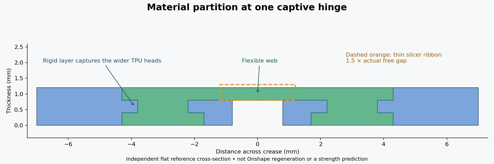
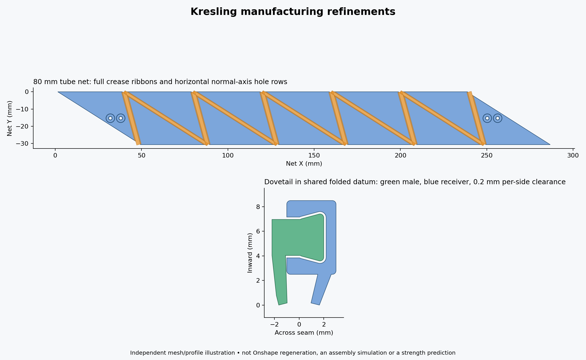

# Manufacturing and connections

This extends the existing folded/net generator. Its default remains a single-material connected model. The source keeps the existing face vertices, inward panel normals, crease adjacency and exact development; new body types are derived from those records rather than a second geometric definition.

This is prototype geometry. The source has not been compiled or regenerated in Onshape during this change. Independent mesh checks exercise the intended geometry and cannot certify FeatureScript execution, FDM reliability, fatigue or splint suitability.

## Body roles and construction modes

Choose **Generation Mode → Material construction**. **Crease modifiers** in the same group independently selects Automatic, Enabled or Disabled:

| Mode | Printable output | Optional nonprinting output |
|---|---|---|
| Single material | The original panels and integral webs united into one solid | Crease modifier parts |
| PLA panels + TPU hinges | Separate PLA panel/island solids and captured TPU crease strips | Crease modifier parts |
| PLA + TPU + slicer modifiers | The same disjoint PLA/TPU material partition | Crease modifier parts, generated automatically |
| Independent single-material modules | One connected solid per cell, with inter-cell webs omitted | Crease modifier parts; optional lacing eyelets |

PLA bodies are named `PLA__rigid__part_N`. TPU bodies include their crease and segment IDs, for example `TPU__crease_1__segment_1__part_1`. Modular bodies use `SINGLE_MATERIAL__module_N`. Orange `MODIFIER_ONLY_NOT_PRINT__crease_N` bodies are **not material**, even though CAD represents them as solids. Colors and names do not automatically assign filaments or modifier behavior in a slicer.

When only some retained creases receive TPU, other creases keep integral rigid-material webs. Those webs can join PLA panels into larger islands. This preserves the original connection graph; it does not guarantee flexibility at a crease left in PLA.

## Captive hinge connection

Each selected crease starts with the original living-web profile and a valid attachment interval inside both trimmed panels. Two-sided captive keys are added inside each adjoining panel:

1. A beam connects the web wing to a through-panel shaft.
2. A wider head at each face captures the shaft within the panel.
3. The exact union of all TPU geometry is subtracted from the PLA with the TPU tools retained.

The output materials therefore meet along zero-gap interfaces instead of competing for the same printed volume. No fit clearance is inserted between co-printed PLA and TPU; the clearance setting governs crease/contact allowances and anchor spacing. A post-assembled clearance-fit key would require a different process and is not implied by these bodies. A retained head is wider than the shaft and cannot withdraw normally through the narrower central neck without material deformation. This is geometric capture, not a measured retention-force claim. Flexible TPU can still pull out, tear or creep under load.

The default **round captive through-rivet** avoids rectangular head corners. **Captive rectangular beam keys** are also available, but their diagonal footprint needs a larger engagement distance. For the default 2.6 mm head, select at least **2.45 mm engagement**, such as 2.6 mm, for rectangular keys.

Both heads are flush with the panel faces: the anchors do not create geometry below the reference bed plane. Two 0.4 mm head pockets leave a 0.4 mm rigid central layer in a 1.2 mm panel. The 0.4 mm web/head dimensions are compatible with two nominal 0.2 mm layers in the flat representation, but the actual toolpaths, extrusion width and supported bridges must still be inspected.

### Hinge controls

| Control | Default | Meaning |
|---|---:|---|
| Creases receiving TPU | All | Mountain, valley, diagonal, axial or section-boundary subsets are available. Caps are included only by All/Mountain/Valley. |
| Different mountain and valley dimensions | Off | Enables independent minimum spans and remaining web thicknesses by geometric fold type. Inverting hinge sides does not change the fold classification. |
| Mountain / valley TPU thickness | 0.4 / 0.4 mm | Must meet the printable web minimum and be no more than 80% of either adjoining wall. |
| Mountain / valley minimum span | 1.6 / 1.6 mm | Replaces the common span in split-material modes; geometric thickness clearance may increase it. |
| TPU web profile | Continuous | One strip per selected crease, or one individually anchored segment per anchor station. This is not one uninterrupted TPU ribbon around the whole structure. |
| Length of each anchored segment | 4 mm | Must fit the attachment interval, contain the connecting beam, and leave clearance to the next segment. |
| Anchor shaft diameter / width | 1.6 mm | Round shaft diameter or square key width. |
| Anchor head diameter / width | 2.6 mm | At least 0.6 mm greater than the shaft. |
| Flush anchor head thickness | 0.4 mm | Each face pocket's depth. A rigid middle layer at least 0.4 mm thick is retained. |
| Anchor center inset into panel | 2.2 mm | Measured from the trimmed crease edge toward the panel interior. Must contain the head envelope plus the chosen ligament. |
| Connecting beam width | 1.2 mm | Along the crease; the beam extends from the web into the anchor. |
| Minimum anchor spacing | 5 mm | Center spacing lower bound; also checked against head width and clearance. |
| Rigid ligament around anchor head | 0.6 mm | Minimum in-plane margin to the inset polygon boundary; head-to-head and accessory contacts are also checked. This minimum needs printer/load calibration. |
| Anchors on each side of each crease | 2 | Distributed along an interval clipped against every original face half-plane. Small cells may require one. |

The generation fails if an anchor does not fit, reaches a lacing, ventilation or end-plate hole, misses its owner, contacts another panel/hinge, or causes the remaining PLA panel to split. Rounded panels, ribs, end caps and holes remain available; not every combination has been tested. A 0.6 mm ligament may be too weak for a particular load or extrusion width even if it passes the geometric guard.

## Slicer modifiers

Choose **Generation Mode → Crease modifiers → Enabled**, or leave it Automatic with **PLA + TPU + slicer modifiers**. Disabled suppresses them even in that manufacturing mode. Automatic also honors the hidden legacy enable flag on saved features. Modifier settings appear only when generation is active.

A modifier is a thin ribbon following both adjoining panel planes and the selected hinge side. A narrow spine spans the free gap; its wings intersect the intended panels. It stays separate from structural unions, TPU subtraction tools and printable connectivity counts.

| Control | Default | Definition |
|---|---:|---|
| Modifier crease types | All | Fold/type filter, independent of the TPU filter. |
| Ribbon width input | Multiplier | Choose relative width or the retained absolute-width input. |
| Width multiplier | 1.5 | Multiplies `gA + gB`, the actual sum of computed panel setbacks, including thickness clearance. This free-gap width excludes overlap and captive-anchor reach. |
| Modifier width across crease | 8 mm | Alternative absolute total width, shown only in Absolute mode. It must cover the gap and enter both panels. |
| Seam coverage | Full crease length | Runs endpoint to endpoint; Printed hinge interval instead uses the validated shortened web attachment interval. |
| Start / end margin (inward) | 0 / 0 mm | Explicit setbacks from the chosen interval. No hidden half-width shortening remains. |
| Modifier surface allowance | 0.1 mm | Extent outside the selected hinge-side panel surface. |
| Modifier penetration from hinge side | 0.4 mm | Inward depth from that surface, capped at the wall thickness. This controls affected material, not physical material thickness. |
| Modifier offset from centerline | 0 mm | Positive shifts width toward adjacency side A; both panel wings must retain positive overlap. |
| Output only modifiers for separate export | Off | Deletes printable parts after validation. Use another instance/configuration with identical geometry parameters for material export. |

Wings are clipped to the actual inset panel footprints. Where needed, only the modifier is trimmed against unrelated panels, hinges or closure hardware. Validation requires one connected ribbon, positive-volume contact with both intended panels, a retained centerline at sampled stations and the requested axial endpoints. An interrupted ribbon is rejected instead of silently shortened. Wide/deep ribbons on tight folded geometries may require smaller dimensions, explicit margins or Printed hinge interval coverage. Modifier overlap with its own hinge is intentional; modifier bodies are not printable material.

Modifier settings are limited to those the installed slicer exposes for a modifier. These bodies do not promise a particular infill direction, filament assignment, wall behavior, or unsupported Bambu option.

### Selecting individual creases

**Export Preparation → Restrict TPU and modifiers to listed crease IDs** enables a list of one-based IDs. The type filter and ID list are combined. Body names reveal selected IDs. IDs are assigned to the full retained graph before modular inter-cell links are removed, so modular outputs may have gaps in numbering. Changing topology, seam, side count, handedness, taper or the restored boundary graph can change IDs; recheck selections after those edits. An empty list or an out-of-range ID is rejected.

## Longitudinal seam and section connections

An exact flat net has distant copies of its seam edge. A local hinge cannot connect those copies in the plane without spanning or crossing the existing net. The feature does not add that unintended bridge or claim that separate edges are connected.

For **Longitudinal seam → Rounded eyelets for post-print lacing**:

- Default inset eyelets place a reinforced hole within each seam-side panel. The full surrounding collar is united with its owner before the lacing hole is cut, so the underlying panel cannot fill the hole again.
- Default eyelets follow the face transformations in both net and folded representations. They do not project into the opposite panel across a closed seam.
- Thread suitable cord, webbing or separately made flexible hardware after wrapping/assembling the structure. No cord or TPU seam strip is generated or load-rated.
- Optional **Protruding assembly tabs (net only)** provide round-ended projecting tabs. They require a post-print assembly allowance and are rejected in Folded mode because those flat extensions can collide at the reference closed seam. They are not a representation of a verified snap-fit seam.

| Eyelet control | Default | Meaning |
|---|---:|---|
| Collar diameter / tab width | 5 mm | Collar diameter or projecting tab width. |
| Minimum collar inset / tab extension | 5 mm | Minimum center distance from the trimmed edge; increased automatically to contain a horizontal row. In projecting mode, extension beyond the reference edge. |
| Lacing hole diameter | 2 mm | Must preserve the minimum printable wall radially. |
| Eyelets on each side of a connection | 1 | Number of holes in each row. Larger counts require adequate panel space. |
| Connection hole layout | Horizontal rows | Centers follow +X of the unrotated net; the legacy along-edge staggered layout remains selectable. |
| Horizontal hole spacing | 6 mm | Center spacing; must exceed collar width plus clearance. |
| Eyelet collar height above panel | 0.4 mm | Extra height on the inner side; zero makes a simple flush hole. Raised collars need padding/contact clearance if used in a splint prototype. |

Every bore remains **normal to its owning panel**, as requested. Hole axes are not rotated sideways. The horizontal row direction is defined in the unrotated XY net and transported rigidly into the folded panels. Parallel seam copies share a row-height datum when both panel footprints permit it. Tapered nets fan out: nonparallel seam copies retain separate horizontal rows instead of forcing holes outside their panels. Section connections also use local horizontal rows. The rest of the assembly is not rotated to conceal an alignment issue; the explicit print-bed rotation still rotates the complete pattern together.

Use Onshape **Top** to inspect circular holes in an XY net. **Front** projects an XY net edge-on, so horizontal centers are visible there but circular openings are not. A two-hole row using 5 mm collars at 6 mm spacing fits the checked 80 mm diameter example; the default 60 mm tube with that two-hole pattern cannot share a paired row datum and is rejected. One hole per side works at the default size.

### Mating dovetail loop closure

Choose **Longitudinal seam → Mating dovetail loop closure**. A rounded male key and complementary open-ended receiver are constructed in one common folded seam frame, then each half is rigidly transported with its owner into the net. This preserves the intended mating relationship rather than making independently oriented decorative tabs. No bridge crosses the flat net.

| Control | Default | Meaning |
|---|---:|---|
| Rail layout | Segmented | Discrete key/receiver pairs, or one continuous rail over the valid attachment interval. |
| Joint material | Rigid | Both halves join rigid panels; TPU-assisted male requires a PLA/TPU mode and uses captive through-anchors. |
| Head width | 4 mm | Widest male cross-section. |
| Engagement depth | 2 mm | Distance from narrow throat to wide head. |
| Dovetail taper angle | 15° | Neck width = head width minus twice depth times tangent of angle. |
| Receiver wall thickness | 1 mm | Must meet the minimum printable wall. |
| Mating clearance per side | 0.2 mm | Outward offset of the male profile, including matching rounded corners. Requires printer-specific fit calibration. |
| Corner radius | 0.3 mm | Analytic circular arcs on the key and receiver profiles. |
| Segments per cell seam | 2 | Segmented layout only; constrained by the available panel attachment interval. |
| Key length along seam | 6 mm | Each segmented male's axial length. |
| Minimum gap between keys | 2 mm | Additional separation beyond each receiver's occupied length. |
| Chamfer the insertion end | Off | Optional male entry-end chamfer. |
| Lead-in chamfer | 0.2 mm | Shown when enabled; must be smaller than the corner radius and one-third of receiver wall thickness. |
| One-way axial end stop | Off | Stops further insertion in one direction. Reverse withdrawal remains possible; this is not a bidirectional lock or tested retention mechanism. |

The receiver cavity is cut after joining its support, so support material cannot refill the socket. Guards check neck width, remaining rounded undercut, owner attachment, separate solid connectivity, collisions with panels/hinges/other joints, and three sampled axial key-entry positions. These are local fit samples, not a compliant folding or whole-assembly insertion simulation. Continuous rails and multiple cells can constrain assembly order; validate the actual insertion path in a physical coupon.

The rails sit inward on local raised supports to clear the wall thickness. They add internal protrusions and may need print support even in Net mode. Check underside bridges, support removal, skin/padding clearance and loads. A TPU male provides geometric capture at its owner; its deformation, pull-out resistance and long-term retention remain unmeasured. The checked combined TPU-assisted example uses **one segment** per seam; larger counts may conflict with neighboring captive anchors and should be tested separately. No snap action or clinical suitability is claimed.

For **Independent single-material modules**, all inter-cell webs are omitted, while each cell's own facets remain connected. Select a section connection:

- **Independent modules:** no extra boundary hardware.
- **Rounded eyelets for section lacing:** complementary lacing stations on both sides of every shared ring edge. After printing, lace the matching module boundaries together. Cord tension and joint play need physical testing.

Layout can retain the assembled coordinates or translate each independent net horizontally into a spaced print layout. Each face, cap, eyelet, internal hinge and modifier within a module receives the same transform. The spaced option affects Net mode only; folded modules retain assembled coordinates. It does not preserve the assembled displacement *between* modules, and no slicer file is claimed to automatically reconstruct that assembly.

Inset section eyelets work with either layout. Projecting section tabs require spaced nets, and spacing must exceed two extensions plus the geometric clearance. **14 mm** is the default reference-envelope spacing. Net rotation is applied after spacing, so rotated layouts may need manual plate arrangement.

In continuous modes, the original boundary policy remains: all exactly developable ring hinges are retained, while tapered or asymmetric boundaries retain only the validated tree bridges when necessary. This is a deliberate cut policy, not a promise of a rigid structural collar.

## Bambu Studio export workflow

1. Generate **Printable net**. Verify the part names and inspect the model in Onshape. The script does not export files or choose a printer profile.
2. Export only printable `PLA__`, `TPU__`, or `SINGLE_MATERIAL__` solids together, preserving their common coordinate system. A single multi-part STEP file is a practical route when the installed Bambu Studio version supports STEP import. Alternatively export meshes from the same origin and import them together as one object with multiple parts.
3. Verify relative position and scale after import. Do not auto-arrange the individual PLA and TPU pieces as separate objects: that destroys the interlock alignment. For spaced independent modules, keep the material pieces of each module together if changing plate arrangement.
4. Assign PLA to the rigid parts and TPU to the flexible parts. Confirm the exact printer, feed system, and TPU product support the planned multi-material switching. Many flexible filaments require different feeding arrangements; a selectable material in CAD does not establish printer compatibility.
5. Export the modifiers separately, using the same parameters, origin, units and layout. In Bambu Studio use the target object's **Add modifier → Load** workflow where offered. Confirm each imported volume has modifier status, and inspect its position before changing settings. Do not import it as ordinary printable material.
6. Set only supported per-modifier settings, then inspect the sliced preview by filament and layer. Check thin webs, necks, the two captive heads, rigid ligaments, bridges, purge volume and possible support trapped in hinge regions. A shallow modifier may affect the TPU as well as PLA where their footprints coincide; preview the actual result.
7. Save the configured **Bambu Studio project as 3MF** to retain the slicer's material assignments and modifier relationships. A generic CAD STEP or 3MF export does not automatically encode Bambu-specific modifier semantics. Onshape's available export formats vary; this feature does not generate a native Bambu project.

### Calibration before a full print

The dimensions above are theoretical CAD defaults. Print a single captured hinge coupon, check section dimensions and fit, and measure peel/pull-out retention, hinge moment, creep and cycle life before scaling up. Verify that the intended layer sequence produces continuous TPU through the panel and that PLA/TPU process temperatures and cooling are compatible. Mechanical capture reduces reliance on adhesion but does not eliminate process dependence. Avoid using a CAD-only prototype to apply orthopedic forces to a person.

## Scope and deferred mechanisms

Implemented: solid single-material output, disjoint PLA/TPU partitions, continuous or segmented captive hinges, round/rectangular through-keys, type/ID selections, slicer-only volumes, horizontal normal-axis lacing rows, net-only round tabs, rounded segmented/continuous dovetail loop closures, and independent laced modules. Existing taper/offset/custom-cell controls are retained with validation.

Not implemented or validated: snap-fit insertion/retention, mushroom snap hardware, pin-and-socket section hardware, permanent flat seam bridges, a generated TPU seam cord, modular multi-material cells in one feature, toolpath-level infill orientation, or automatic native Bambu 3MF authoring. They are not selectable placeholder modes. Captive through-keys and post-print lacing are the practical alternatives provided here. These need physical calibration and cannot establish safe splint loading, clinical use, or a collision-free compliant folding path.

## Example settings

Keep common geometry at six sides, 60 mm diameter, 30 mm per cell and 75° twist.

| Example | Manufacturing settings | Expected role counts |
|---|---|---|
| Captured one-cell net | PLA panels + TPU hinges; All; Continuous; round rivets; two anchors per side | 12 PLA parts, 11 TPU strips, 44 captive anchors |
| Segmented one-cell net | Same, with Individual anchored segments; length 4 mm | 12 PLA parts, 22 TPU segments |
| Crease infill study | PLA + TPU + slicer modifiers; width multiplier 1.5, surface allowance 0.1 mm, penetration 0.4 mm | Above material parts plus 11 slicer-only bodies |
| Dovetail loop net | Default one-cell geometry; mating dovetail; rigid; two 6 mm segments | Integrated male/receiver pairs with intentional sliding clearance |
| Horizontal lacing study | 80 mm diameter; lacing; two eyelets per side; horizontal spacing 6 mm | Two holes in each horizontal seam-side row, with normal bore axes |
| Modular laced pair | Two cells; Independent single-material modules; section lacing; inset eyelets; Spaced | Two printable modules with twelve integrated section eyelets |

These are independent-mesh expectations for the stated configurations, not observed Onshape part counts. Material-island counts change when TPU filters leave rigid connecting webs.
