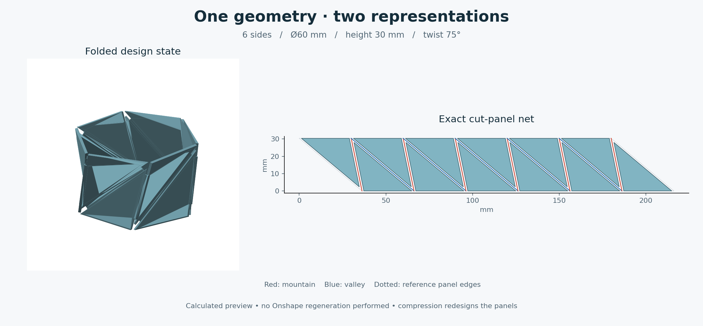

# Kresling Engineering for Onshape

A parametric FeatureScript generator for folded Kresling design states and matching printable cut-panel nets. Uses FeatureScript **2144** and standard library **2144.0**.



## Use in Onshape

1. Open [kreslingEngineering.fs](kreslingEngineering.fs) and copy the **entire file**.
2. Create a Feature Studio in your Onshape document.
3. Click inside its code editor, select all starter text, and replace it with the copied source. The single `FeatureScript 2144;` header must be on line 1.
4. Click **Commit**, then add **Kresling Engineering** to a Part Studio through the custom-feature menu.
5. Choose **Folded solid** or **Printable net**. Keep all other settings identical when generating a matching pair.

Start with the defaults: six sides, 60 mm circumdiameter, one 30 mm cell, 75° twist, 1.2 mm panels, and 0.4 mm hinge webs.

## Features

- Folded design states and exact unfolding of reference and inset panels.
- Repeated cells, consistent or alternating handedness, and selectable seams.
- Constant, linear, progressive, and custom cross-section schedules with offsets.
- Configurable panel thickness, hinge webs, gaps, overlap, and manufacturing limits.
- Optional hinged end plates, local holes, ventilation, reinforcement islands, rounded panel corners, and slotted attachment tabs.
- Checks for collapsed insets, overlapping nets, unintended component contacts, and disconnected results.

See the [engineering guide](ENGINEERING_GUIDE.md) for every parameter, geometry equations, example configurations, deliberate cuts, printing considerations, and limitations.

## Current validation status

This is the latest corrected source from development. It includes fixes for FeatureScript reserved-keyword access (`hit["type"]`) and the duplicate custom-cell parameter ID (`cell.cellTwist` / `row.cellTwist`). **Successful Onshape recompilation and B-rep regeneration have not yet been confirmed after these fixes.**

An independent Python numerical model and mesh Boolean kernel passed 13 representative designs in both representations and rejected five invalid configurations. Those checks do not execute or compile the FeatureScript. Details and the source hash are in [VALIDATION.md](VALIDATION.md); machine-readable results are in [validation_results.json](validation_results.json).

## Reproduce the independent checks

```bash
python -m venv .venv
.venv/bin/pip install -r requirements-validation.txt
.venv/bin/python verify_geometry.py
.venv/bin/python make_preview.py
```

On Windows, use `.venv\Scripts\python.exe` and `.venv\Scripts\pip.exe`. The verification script recreates its mesh files before the preview script uses them.

## Mechanical scope

Compression changes the designed panel dimensions; it does not simulate a single fixed net folding continuously. Panel dimensions unfold exactly, while finite-thickness hinge bend allowances remain unsolved. Some tapered or asymmetric connections need relief cuts. Locking mechanisms and transitions between different side counts require separate components.

This geometry is intended for engineering prototypes. CAD and mesh checks do not establish fatigue life, load capacity, or medical suitability. See the guide for the physical testing needed before splint-related use.
